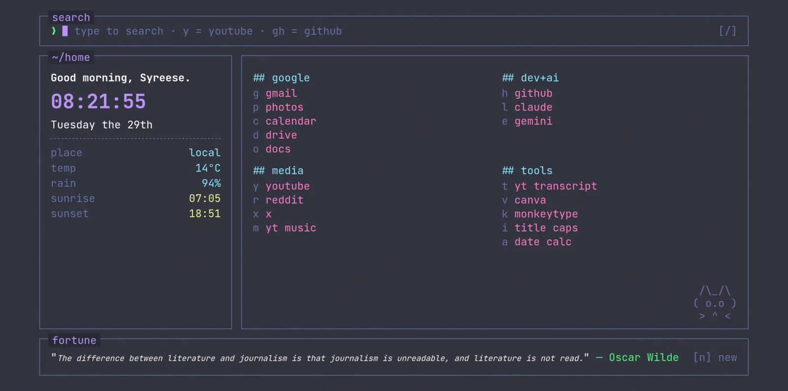
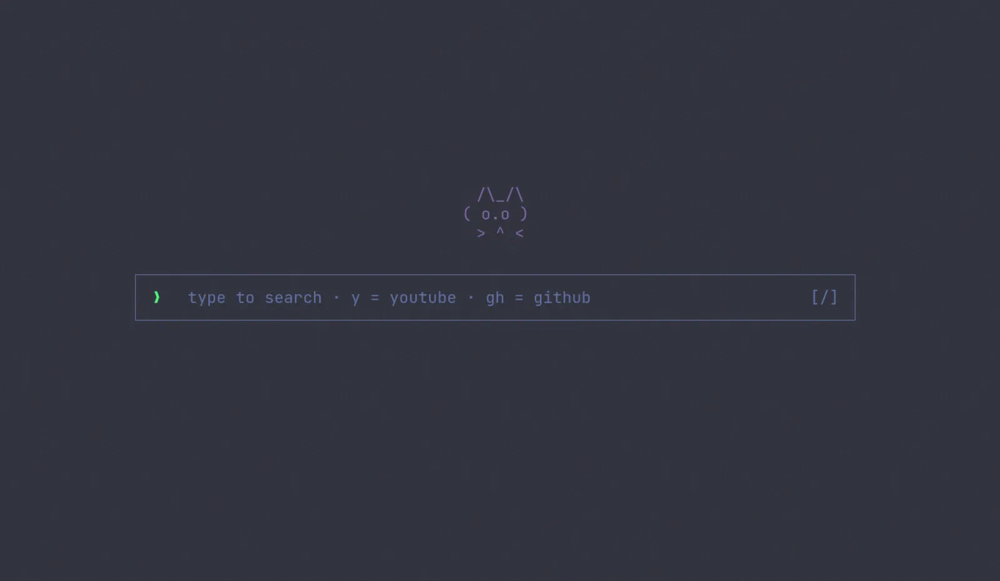

# home

A fast, keyboard-driven start page styled like a terminal TUI. Built to replace Firefox's new tab page: static files, no build step, no tracking. Works offline except for the weather.

## Features

- **Live clock & date** with a time-based greeting (click the clock to toggle 12/24 h)
- **Weather** via [Open-Meteo](https://open-meteo.com/): conditions, feels-like, high/low, wind, rain, sunrise/sunset, 3-day outlook. Cached for 15 min in `localStorage`.
- **Quotes** bundled in `quotes.js` (no request), one-key refresh
- **Quick-launch links** grouped by category, each with a single-key shortcut; most-used links float to the top of their group
- **Search bar** with engine prefixes (see below); URLs and `localhost:3000` open directly
- **Themes**: Dracula, Nord, Gruvbox, light
- JetBrains Mono self-hosted, subtle grain + hover glow, respects `prefers-reduced-motion`

### Keyboard shortcuts

| Key | Action |
|---|---|
| `/` | Focus the search bar |
| `Esc` (in search) | Leave the search bar so link keys work |
| link key (`g`, `h`, `y`...) | Open that link (search bar unfocused) |
| link key + `Enter` (in search) | Same, without leaving the search bar: `g` `Enter` = Gmail |
| `n` | Load a new quote |
| `1` `2` `3` `4` | Theme: dracula, nord, gruvbox, light |
| `Enter` (in search) | Run the search |

### Search prefixes

`y` YouTube, `gh` GitHub, `w` Wikipedia, `d` DuckDuckGo, `mdn`, `npm`, `aur`, `r` Reddit. Example: `gh ripgrep`. Anything else goes to Google. Edit `ENGINES` in `search.js` to change them.

## Install

No dependencies, no build. Keep all files together in one folder: `index.html` needs `base.css`, `theme.js`, `quotes.js`, `search.js`, `app.js` and `fonts/` beside it.

1. Clone or download this repo
2. Open `about:preferences#home` in Firefox
3. Set **Homepage and new windows** to **Custom URL...** and point it at the local file path (e.g. `file:///path/to/index.html`)

Or just double-click `index.html` to preview it in any browser.

### New tabs (`minimal.html`)

Firefox's homepage setting only covers the homepage and new *windows*; it has no custom URL option for new *tabs*. For that you need the [New Tab Override](https://addons.mozilla.org/en-US/firefox/addon/new-tab-override/) extension:

1. Install New Tab Override
2. In its settings, choose **Local file** and select `minimal.html`

New Tab Override runs pages in a restricted extension context, so API calls don't reliably work there. `minimal.html` is a stripped-down page: just the ASCII cat and the search bar (no weather, quotes, or links). It needs `base.css`, `theme.js`, `search.js` and `fonts/` beside it. Use `index.html` for the homepage and `minimal.html` for new tabs.

## Customize

Everything personal lives in the `CONFIG` block at the top of `app.js`:

- `name`: greeting name
- `home`: `{ name, lat, lon }` used for the weather
- `geolocate`: `true` asks the browser for your location (permission prompt, falls back to `home`)
- `units`: `'metric'` or `'imperial'`
- `hour12`: default clock format
- `useQuoteApi`: `true` fetches quotes from an online API instead of `quotes.js`
- `links`: groups of `[key, label, url]`

Other places:

- **Colors / themes**: CSS variables at the top of `base.css`
- **Quotes**: `quotes.js`
- **Search engines**: `ENGINES` in `search.js`

## License

MIT, see `LICENSE`. JetBrains Mono is licensed under the SIL Open Font License (`fonts/OFL.txt`).
